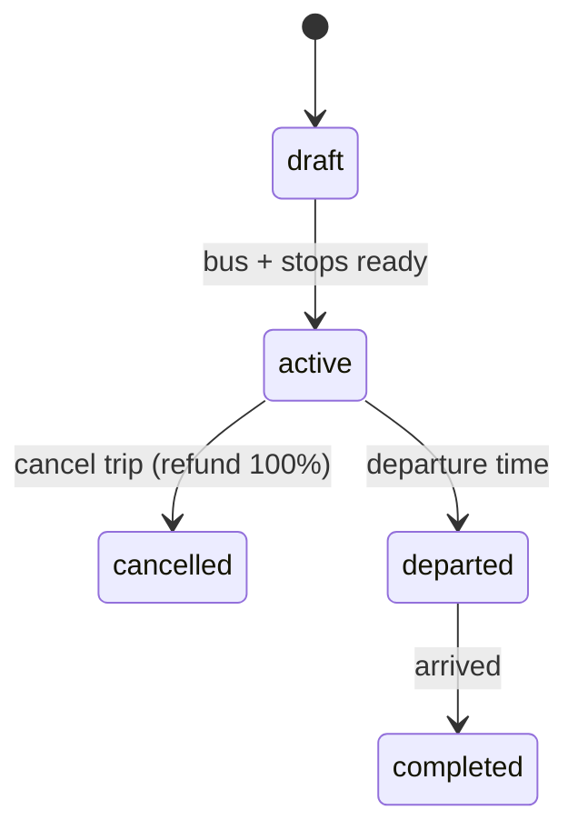
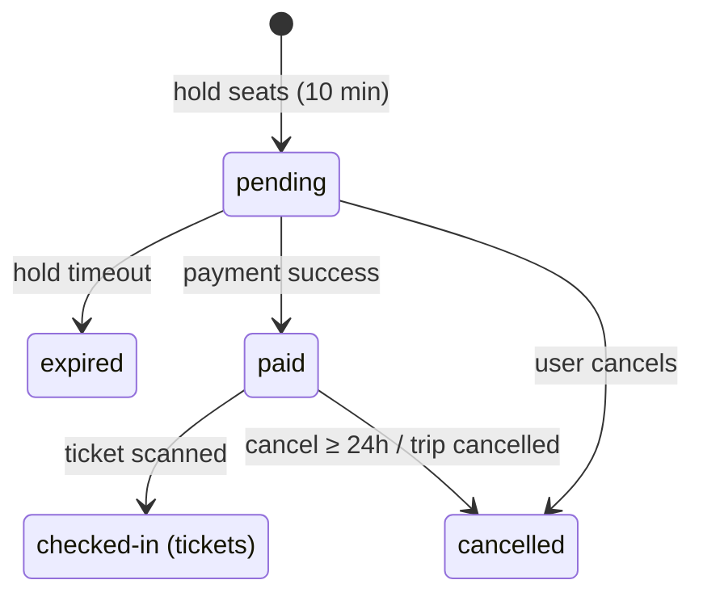

# Mô tả project

- Xây dựng ứng dụng web "Bus Ticket Booking System" – nền tảng đặt vé xe khách liên tỉnh tại Việt Nam, cho phép:
  - Khách hàng tìm chuyến xe với gợi ý điểm đi, điểm đến tự động (autocomplete), lọc và sắp xếp kết quả.
  - Chọn ghế trên sơ đồ ghế trực quan; trạng thái ghế được cập nhật liên tục trong lúc chọn.
  - Đặt vé trọn vẹn: chọn điểm đón/trả, nhập thông tin hành khách, thanh toán (cổng thanh toán giả lập) và nhận vé điện tử qua email; hủy vé theo chính sách.
  - Đặt vé không cần tài khoản (guest checkout) và tra cứu vé bằng mã đặt chỗ.
  - Trợ lý ảo (chatbot) hỗ trợ tìm chuyến, tra cứu vé và giải đáp chính sách.
  - Quản trị viên quản lý bến xe, tuyến, xe, chuyến, đặt chỗ, tin tức, người dùng; nhân viên soát vé (check-in) hành khách.
  - Thống kê doanh thu, số vé bán, tỉ lệ lấp đầy theo thời gian và theo tuyến.
- Quy mô: nhóm 5 sinh viên. Các chức năng được chia thành 5 nhóm full stack có khối lượng tương đương; mỗi thành viên phụ trách trọn vẹn một nhóm.
- Yêu cầu chung:
  - Ứng dụng web render phía server (SSR) trên nền Node.js, Express.js và PostgreSQL; một số thành phần cập nhật một phần trang bằng AJAX.
  - Giao diện tiếng Việt, responsive trên điện thoại, máy tính bảng và máy tính; ứng dụng chính dùng Bootstrap, các trang tĩnh dùng Tailwind CSS.
  - Ứng dụng khởi chạy được bằng Docker Compose trên máy bất kỳ, có sẵn dữ liệu mẫu để demo; mã nguồn quản lý bằng Git.

## 1. Vai trò người dùng

| Vai trò | Mô tả | Quyền chính |
|---|---|---|
| Khách vãng lai (guest) | Người dùng chưa đăng nhập | Tìm chuyến, xem chi tiết chuyến, đặt vé không cần tài khoản, tra cứu và hủy vé bằng mã đặt chỗ, xem tin tức, dùng trợ lý ảo. |
| Khách hàng (customer) | Người dùng đã đăng ký và xác thực email | Các quyền của khách vãng lai; quản lý hồ sơ; xem lịch sử đặt vé; hủy vé theo chính sách. |
| Nhân viên (staff) | Nhân viên nhà xe tại bến | Xem danh sách hành khách của chuyến, soát vé (check-in). |
| Quản trị viên (admin) | Người quản lý hệ thống | Toàn quyền: quản lý danh mục, chuyến, đặt chỗ, nội dung, người dùng; xem báo cáo. |

## 2. Luồng nghiệp vụ chính

- **Thiết lập hệ thống:** admin đăng nhập → tạo bến xe, điểm đón/trả → tạo tuyến và điểm dừng → khai báo sơ đồ ghế, xe → lập lịch chuyến.
- **Đăng ký tài khoản:** đăng ký → xác thực email → đăng nhập → xem lịch sử đặt vé.
- **Đặt vé (khách hàng):** tìm chuyến → chọn chuyến → chọn ghế → nhập thông tin → thanh toán → nhận vé điện tử.
- **Đặt vé (khách vãng lai):** tìm chuyến → chọn chuyến → chọn ghế → nhập thông tin (không cần tài khoản) → thanh toán → nhận vé điện tử → tra cứu vé bằng mã đặt chỗ.
- **Vận hành chuyến:** admin tạo chuyến → gán xe → cấu hình điểm dừng → mở bán (active) → hành khách đặt vé → nhân viên soát vé → xe xuất bến (departed) → hoàn thành chuyến (completed).
- Trạng thái của chuyến và đặt chỗ thay đổi theo sơ đồ sau:

**Trip lifecycle**

↓ *active trips accept bookings*

**Booking lifecycle**

*Hình 1. Vòng đời của chuyến (trip) và đặt chỗ (booking)*

## 3. Phân chia nhóm chức năng

- Mỗi nhóm chức năng do một thành viên phụ trách từ dữ liệu, xử lý đến giao diện:

| Thành viên | Nhóm chức năng | Phạm vi |
|---|---|---|
| Thành viên 1 | Tài khoản, xác thực và bảo mật | Đăng ký, xác thực email, đăng nhập, quên mật khẩu; hồ sơ, lịch sử đặt vé; phân quyền; quản lý người dùng; bảo mật chung. |
| Thành viên 2 | Danh mục vận hành và nội dung | Giao diện quản trị chung; bến xe, điểm đón/trả, tuyến, sơ đồ ghế, xe; tin tức, khuyến mãi, FAQ, chính sách; trang tĩnh. |
| Thành viên 3 | Lịch chạy và tìm kiếm chuyến | Giao diện khách hàng chung; quản lý chuyến, lập lịch, điểm dừng, vòng đời chuyến; trang chủ, tìm chuyến, chi tiết chuyến. |
| Thành viên 4 | Đặt vé, chọn ghế và thanh toán | Sơ đồ chọn ghế, giữ ghế; quy trình đặt vé; thanh toán giả lập; tra cứu, hủy vé; dữ liệu dùng chung. |
| Thành viên 5 | Vé điện tử, vận hành, báo cáo và trợ lý ảo | Vé điện tử, email vé; quản lý đặt chỗ; soát vé; dashboard, báo cáo; trợ lý ảo; triển khai, kiểm thử tích hợp. |
